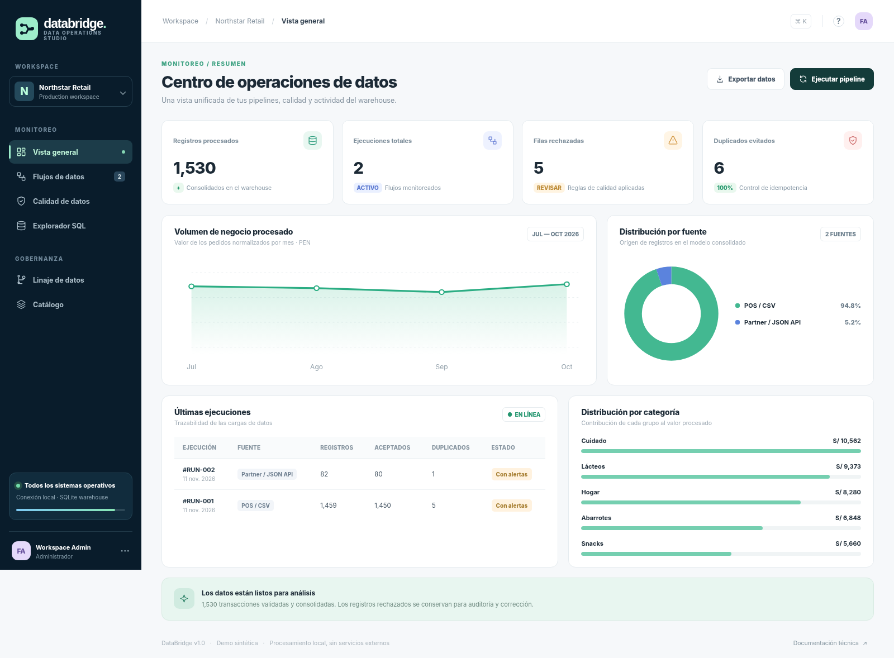
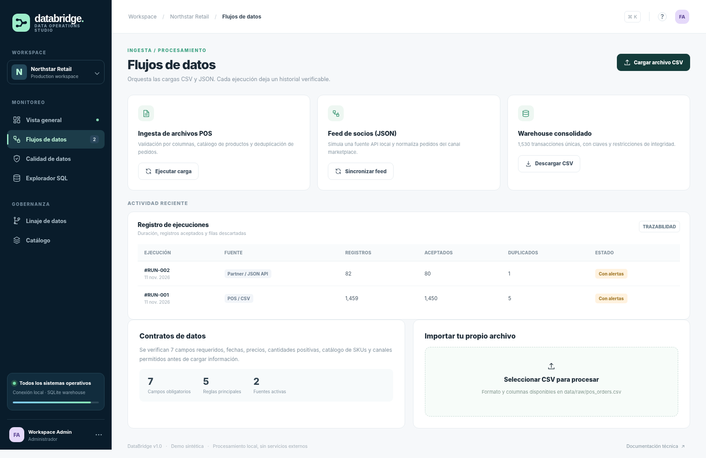
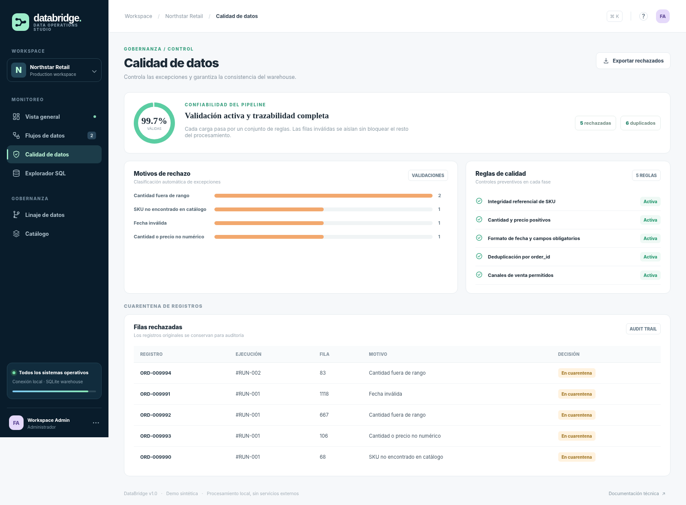
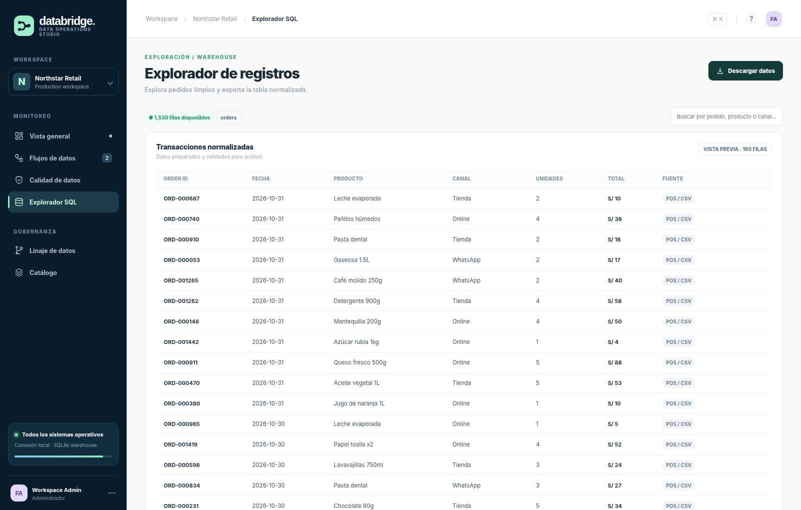
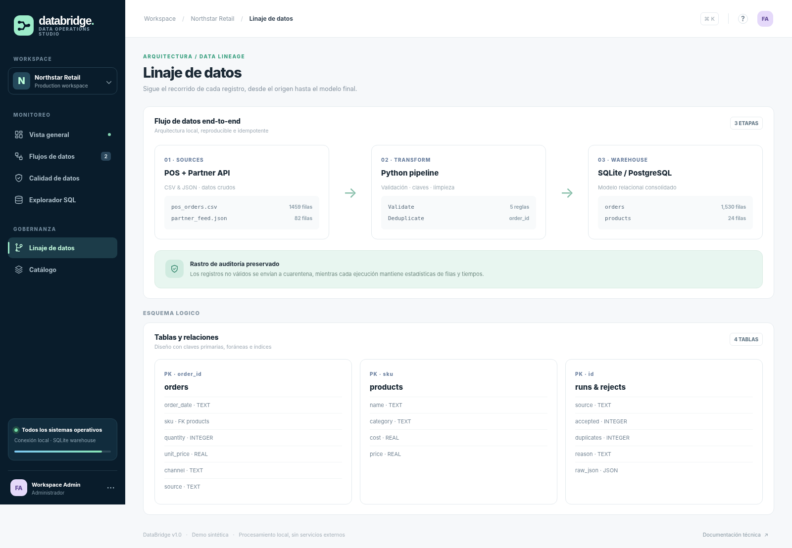
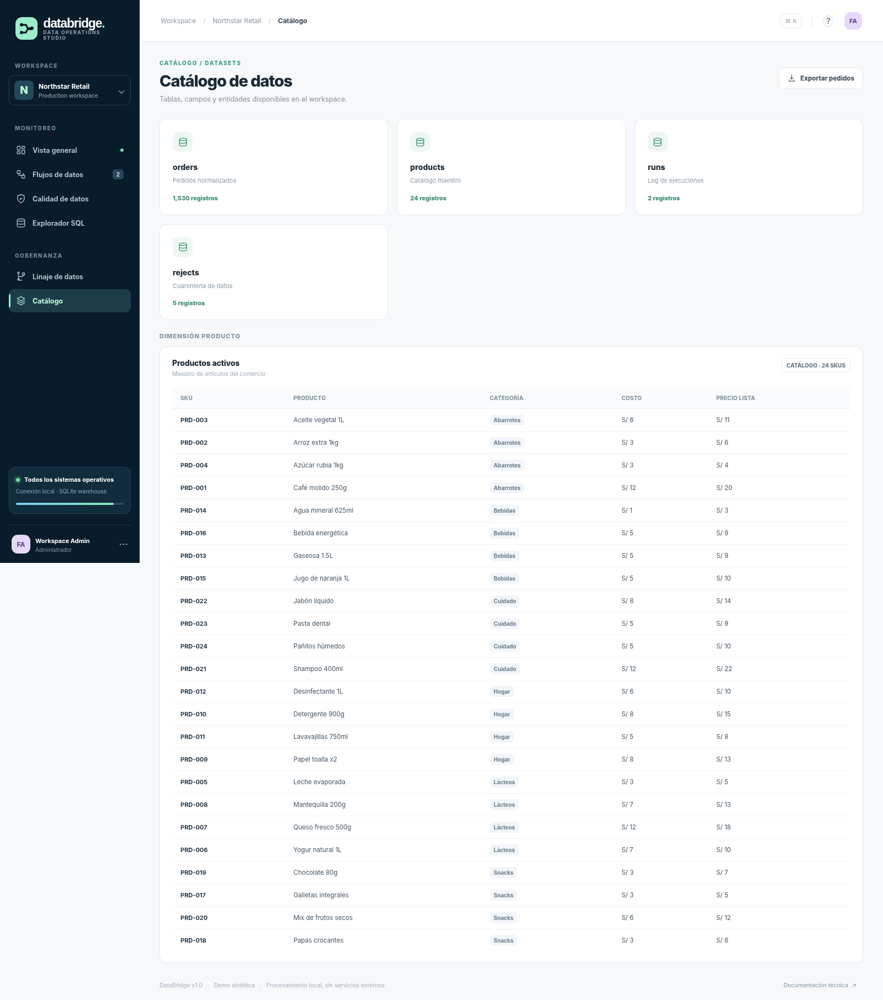

<div align="center">

# DataBridge
**Data pipelines · Data Quality · Observabilidad**

Una plataforma de integración de datos para centralizar pedidos de un comercio, detectar errores de origen y publicar una base consolidada para análisis.

   

</div>



## ¿Qué problema resuelve?

Las ventas llegan desde diversas fuentes con formatos inconsistentes: pedidos duplicados, fechas erróneas, productos no reconocidos y valores inválidos. **DataBridge** proporciona un flujo sencillo de ingesta, transformación, validación, cuarentena y seguimiento de ejecuciones sin exigir servicios en la nube.

> **Contexto:** laboratorio de ingeniería de datos basado en **Northstar Retail, un negocio ficticio**. Todos los pedidos, precios, clientes y resultados de demostración son sintéticos. No está desplegado públicamente.

## Funcionalidades

- **Ingesta CSV:** importa los pedidos de un sistema POS y permite subir nuevos archivos desde la web.
- **Ingesta JSON:** consume un feed JSON local que representa la respuesta de un proveedor externo / API. No requiere credenciales ni internet.
- **Calidad de datos:** valida columnas, fechas, SKUs, canales, cantidades y precios.
- **Deduplicación:** clave única `order_id`, por lo que reejecutar una carga no crea pedidos repetidos.
- **Cuarentena y auditoría:** guarda la fila original y el motivo de rechazo, junto con el historial de ejecuciones.
- **Warehouse SQL:** modelo relacional con pedidos, productos, cargas y rechazos.
- **Exploración y exportación:** dashboard, tablas, indicadores, CSV limpio y CSV de errores.
- **PostgreSQL opcional:** `docker-compose.yml`, esquema SQL y script de sincronización desde la demo SQLite.

## Capturas de la aplicación

| Flujos de datos | Calidad de datos |
|:--:|:--:|
|  |  |
| **Explorador de registros** | **Linaje de datos** |
|  |  |

**Catálogo de datos**



*Las pantallas corresponden al frontend del repositorio, renderizado con respuestas del backend generadas a partir de los datasets de demostración.*

## Tecnologías aplicadas

| Área | Tecnologías / conceptos |
|---|---|
| ETL | Python, módulo `csv`, transformación y validación tipada con `decimal` |
| API | FastAPI, endpoints REST, subida de archivos CSV |
| Persistencia | SQLite (demostración rápida), PostgreSQL 16 como extensión local opcional |
| Frontend | HTML, CSS responsive, JavaScript y gráficos SVG sin frameworks pesados |
| Ingeniería de datos | Deduplicación, validación, cuarentena, auditoría, esquema relacional |
| Calidad | Pytest, GitHub Actions |

## Ejecutar localmente

Requiere **Python 3.12 o superior**. Los siguientes comandos funcionan en Windows PowerShell o terminal Linux/macOS con el entorno virtual activado.

```bash
python -m venv .venv
```

Activación en Windows PowerShell: `.venv\Scripts\Activate.ps1`  
Activación en Linux/macOS: `source .venv/bin/activate`

```bash
pip install -r requirements.txt
python tools/generate_data.py
python -m uvicorn app.main:app --reload --port 8008
```

Abrir **http://127.0.0.1:8008**. La primera ejecución crea o reutiliza `data/databridge.sqlite3` y, cuando no hay cargas, procesa automáticamente los datos de ejemplo.

**Para empezar desde cero:** borra `data/databridge.sqlite3` y reinicia el servidor. Se reconstruirá con los CSV y JSON incluidos.

## Opcional: PostgreSQL con Docker

La aplicación web funciona de forma autónoma con SQLite. Para demostrar migración/exportación a PostgreSQL:

```bash
docker compose up -d
pip install "psycopg[binary]"
python -m tools.sync_postgres
```

PostgreSQL estará disponible en `localhost:5434`, con BD `databridge`, usuario `databridge` y contraseña local de ejemplo `localdemo` (solo para desarrollo). El script **sincroniza** productos y pedidos limpios a la base PostgreSQL; la API de demo sigue leyendo SQLite. El entorno PostgreSQL no es un despliegue cloud.

## API resumida

| Método | Endpoint | Función |
|---|---|---|
| GET | `/api/overview` | Indicadores, ejecuciones, tendencias |
| GET | `/api/quality` | Errores y motivos de rechazo |
| GET | `/api/orders` | Vista previa de pedidos limpios |
| POST | `/api/pipelines/pos` | Reprocesar CSV demo |
| POST | `/api/pipelines/partner` | Reprocesar feed JSON |
| POST | `/api/pipelines/upload` | Subir archivo CSV (`multipart/form-data`) |
| GET | `/api/export/orders.csv` | Descargar pedidos consolidados |
| GET | `/api/export/rejects.csv` | Descargar filas rechazadas |
| GET | `/docs` | Documentación interactiva OpenAPI (FastAPI) |

## Pruebas

```bash
pip install -r requirements-dev.txt
python -m pytest -q
node --check frontend/app.js
```

Las pruebas cubren reglas de calidad, idempotencia y endpoints. La interfaz puede examinarse sin backend de pago, con datos locales reproducibles. El diseño está preparado como proyecto educativo, no como pipeline de producción multiempresa.

## Estructura

```text
DataBridge/
├── app/                 # FastAPI y motor ETL
├── frontend/            # Dashboard responsive
├── tools/               # Generador de datos y exportación opcional a PostgreSQL
├── data/raw/            # POS CSV, catálogo CSV, partner JSON
├── data/databridge.sqlite3 # Ejemplo precargado
├── sql/                 # Esquema PostgreSQL
├── tests/               # Pytest
├── docs/                # Arquitectura, diccionario y screenshots
├── .github/workflows/   # Checks automáticos
├── docker-compose.yml
└── README.md
```

Más detalles en [Arquitectura](docs/ARCHITECTURE.md) y [Diccionario de datos](docs/DATA_DICTIONARY.md).

### Relación con SQL Clinic

Ambos proyectos usan el concepto de **Northstar Retail**. Aquí se demuestra la **integración y calidad de datos**, mientras que **SQL Clinic** (repositorio independiente) se enfoca en **índices y rendimiento SQL**. No intercambian bases de datos ni requieren instalarse juntos.

## Autor y licencia

**Fanaker Labs** · Proyecto personal de integración de datos, ETL y calidad de información. Código bajo licencia [MIT](LICENSE).
