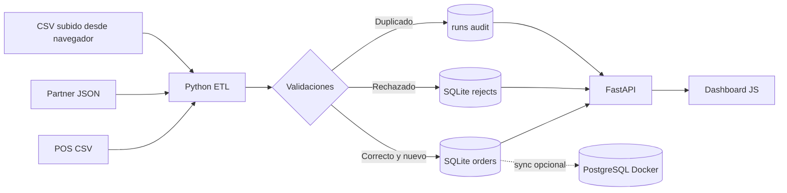

# Arquitectura de DataBridge

## Flujo de procesamiento

1. Se carga el catálogo maestro de 24 productos.
2. Se interpreta la fuente CSV o JSON con el mismo contrato de campos.
3. Se valida orden, fecha, cantidad entera positiva, precio positivo, canal y SKU.
4. Se intenta insertar la fila válida. `order_id` es único; ante conflicto se cuenta como duplicado.
5. Las filas inválidas se guardan íntegramente en `rejects`, asociadas al `run_id`.
6. Se actualiza el registro de auditoría con totales y duración.
7. La API publica agregaciones y vistas para el dashboard.

## Decisiones

- **SQLite como inicio rápido:** permite comprobar el proyecto sin Docker ni coste. Existe una **ruta opcional a PostgreSQL** para practicar DDL y sincronización.
- **Clave única y transacción:** controles de idempotencia, y consistencia de carga parcial. Aun con errores de una fila, el resto se conserva.
- **Dataset sintético y determinista:** semilla `607`, replicable, con cuatro errores deliberados y duplicados explícitos.
- **Sin servicios externos:** el feed JSON representa la respuesta de una API comercial sin depender de disponibilidad ni credenciales.

## Límites conscientes

No hay autenticación multiusuario, scheduling distribuido, concurrencia multiworker, retención automatizada, ni conectores reales de terceros. Los datos no son reales; las duraciones y métricas se calculan localmente. No se usa Pandas: la limpieza aquí se realiza con biblioteca estándar para reducir instalaciones y mantener el ejemplo enfocado.
